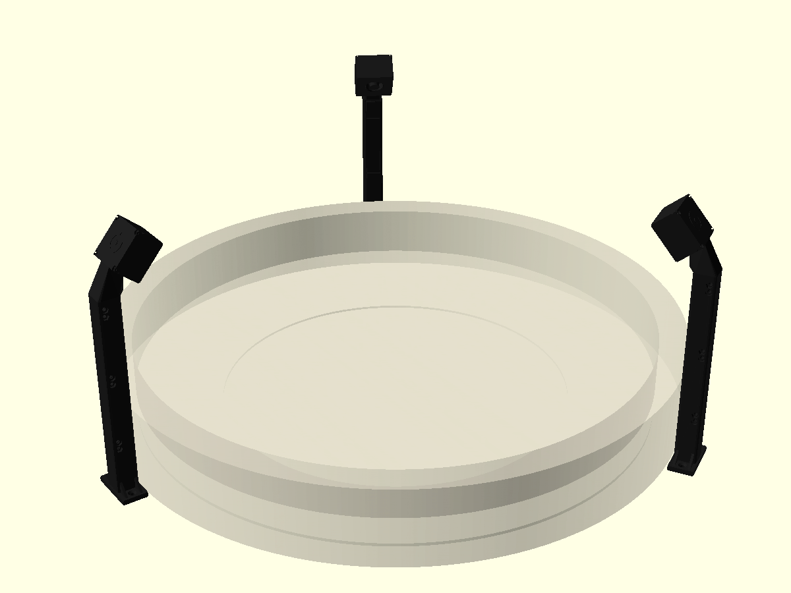

# OpenDarts

OpenDarts is an open steel-tip darts project: a web app for playing and scoring, and camera detection with three cameras on 3D-printed arms.

- **App:** game modes, scoring, statistics. Runs in the browser, against bots, locally or online with friends.
- **Detection:** three USB cameras spaced 120° apart around the board. The arms fit the Target Corona, the Winmau Plasma, or mount universally on the wall.

*Render of the camera arms (universal wall mount). Work in progress, not yet test-printed.*

## Status

The project is under development. Code and a build guide will be added to this repository step by step.

## Installation

There is nothing to install from this repository yet. Once released, this section will describe:

1. the web app, which runs in the browser,
2. the detection software for Windows,
3. assembling the camera arms (three OV9732 USB cameras with 100° lenses, USB cable or hub, screws, PETG).

Please report bugs and ideas as an [issue](https://github.com/timojeschke/opendarts/issues).

## License

The code and documentation in this repository are released under the [MIT License](LICENSE).

**Not covered by the MIT License:** the 3D print files for the camera arms (STL/3MF) are sold separately and are not part of this repository. They come with their own license for private use. The render image above only shows the design; it does not grant any rights to the print files.

---

The names Target, Corona, Winmau and Plasma only describe the fit. Windows is a trademark of the Microsoft group of companies. All trademarks belong to their respective owners.
